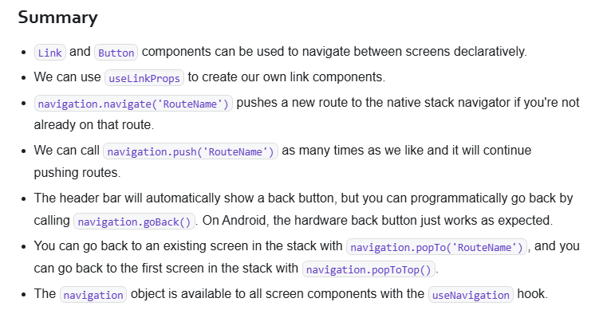

# Navigation

## React Navigation
- [React Navigation Starter Template](https://reactnavigation.org/docs/getting-started#starter-template)
- [React Navigation installation](https://reactnavigation.org/docs/getting-started#installation)
  - The `@react-navigation/native` package contains the core functionality of React Navigation
  - `npm install @react-navigation/native` or `npx expo install @react-navigation/native`
  - `npx expo install react-native-screens react-native-safe-area-context`
 
---

## Terms

### Navigator
- A **Navigator** is React component that decides how to render the screens you have defined. 
- It contains Screen elements as its children to define the configuration for screens.

### NavigationContainer
- **NavigationContainer** is a component which manages our navigation tree and contains the navigation state.
- This component must wrap all navigators structure. Usually, we'd render this component at the root of our app, which is usually the component exported from App.js.

```javascript
function App() {
  return (
    <NavigationContainer>
      <Stack.Navigator>  {/* <--- This is a Navigator */} 
        <Stack.Screen name="Home" component={HomeScreen} />
      </Stack.Navigator>
    </NavigationContainer>
  );
}
```

### Navigation state
- Refer:https://reactnavigation.org/docs/navigation-state
- The **navigation state** is the state where React Navigation stores the navigation structure and history of the app. 
- It's useful to know about the structure of the navigation state if you need to do advanced operations such as resetting the state, providing a custom initial state etc.
- It is a JavaScript object that looks like

```javascript
const state = {
  type: 'stack',
  key: 'stack-1',
  routeNames: ['Home', 'Profile', 'Settings'],
  routes: [
    { key: 'home-1', name: 'Home', params: { sortBy: 'latest' } },
    { key: 'settings-1', name: 'Settings' },
  ],
  index: 1,
  stale: false,
};
```
- There are few properties present in every navigation state object:
  - type: Type of the navigator that the state belongs to, e.g. stack, tab, drawer.
  - key - Unique key to identify the navigator.
  - routeNames - Name of the screens defined in the navigator. This is a unique array containing strings for each screen.
  - routes - List of route objects (screens) which are rendered in the navigator. It also represents the history in a stack navigator. There should be at least one item present in this array.
  - index - Index of the focused route object in the routes array.
  - history - An optional list of visited items. See History stack for more details.
  - stale - A navigation state is assumed to be stale unless the stale property is explicitly set to false. This means that the state object needs to be "**rehydrated**".


- Each route object in a routes array may contain the following properties:
  - key - Unique key of the screen. Created automatically or added while navigating to this screen.
  - name - Name of the screen. Defined in navigator component hierarchy.
  - params - An optional object containing params which is defined while navigating e.g. navigate('Home', { sortBy: 'latest' }).
  - state - An optional object containing the stale navigation state of a child navigator nested inside this screen.

### Screen Component
- A screen component is a component that we use in our route configuration.

```javascript
const Stack = createNativeStackNavigator();

const StackNavigator = (
  <Stack.Navigator>
    <Stack.Screen
      name="Home"
      component={HomeScreen} // <----
    />
    <Stack.Screen
      name="Details"
      component={DetailsScreen} // <----
    />
  </Stack.Navigator>
);
```
- The suffix `Screen` in the component name is entirely optional, but a frequently used convention; we could call it `Michael` and this would work just the same.

### Navigation object
- Detailed Info: https://reactnavigation.org/docs/navigation-object
- The navigation object contains methods used for navigation. It contains methods such as:
  - `dispatch` will send an action up to the router.
  - `navigate`, `goBack`, etc are available to dispatch actions in a convenient way.
- This object can be accessed with the `useNavigation` hook. It's also passed as a prop to screens defined with the dynamic API.

### Route object
- Detailed Info: https://reactnavigation.org/docs/route-object/
- Each screen component in your app is provided with the route object as a prop automatically. The prop contains information about the current route i.e., params, key and name. It can also contain arbitrary params:

```aiignore
{
  key: 'B',
  name: 'Profile',
  params: { id: '123' }
}
```

### Header
- Also known as navigation header, navigation bar, app bar, and probably many other things. This is the rectangle at the top of your screen that contains the back button and the title for your screen. 
- The entire rectangle is often referred to as the header in React Navigation.

---

### Setting up React Navigation
- When using React Navigation, we configure **navigators** in our app. **Navigators** handle transitions between screens and provide UI such as headers, tab bars, etc.
- There are 2 ways to configure navigators:
    - **Static Configuration**
        - Object-based configuration with automatic TypeScript types & deep linking.
        - Supports static screen lists with dynamic navigator options.

    - **Dynamic Configuration**
        - Component-based configuration with significantly more boilerplate.
        - Supports dynamic screen lists & navigator options.

---

### Web Browser Navigation Behavior
- In a web browser, clicking a link pushes a page onto the browser's history stack, and pressing the back button pops the page from the stack, making the previous page active again.
- React Native doesn't have a built-in history like a web browser - this is where React Navigation comes in.

### Mobile Navigation Behavior
- The **Native Stack Navigator** keeps track of visited screens in a history stack. 
- It also provides UI elements such as headers, native gestures, and animations to transition between screens etc. that you'd expect in a mobile App.
- Each navigator in React Navigation lives in its own library.

---

## Native Stack Navigator
- [Native Stack Navigator Reference](https://reactnavigation.org/docs/hello-react-navigation#installing-the-native-stack-navigator-library)
- Libraries
  - `npx expo install @react-navigation/native-stack` or `npm install @react-navigation/native-stack`
  - `npx expo install @react-navigation/elements` or `npm install @react-navigation/elements`
    - The `@react-navigation/elements` library provides components designed to work with React Navigation like `Button` etc.
  - Make sure you've already installed `@react-navigation/native` & [associated libraries](https://reactnavigation.org/docs/getting-started#installation).

### Moving between screens

**Way 1:** Using the `Link` component from `@react-navigation/native` or the `Button` component from `@react-navigation/elements`
  - Refer: https://reactnavigation.org/docs/navigating#using-link-or-button-components
  - The `Link` and `Button` components accept a `screen` prop specifying where to navigate when pressed.
  - The built-in `Link` and `Button` components have their own styling. To create custom link or button components matching your app's design, see the `useLinkProps` hook.


**Way 2:** Using the `navigation` object
  - This method gives you more control over when & how navigation happens.
  - The `navigation` object is available in your screen components through the `useNavigation` hook
    - The useNavigation hook returns the navigation object. We can call navigate with the route name we want to go to.

    
### Navigate to a screen multiple times
  - What happens if we navigate to Details again while already on the Details screen?
    - `navigation.navigate()` function will do nothing.
    - `navigation.push()` function adds another route regardless of the existing navigation history
    - Each push call adds a new route to the stack, while navigate only pushes if you're not already on that route.

### Going back
  - The native stack navigator's header automatically shows a back button when there's a screen to go back to.
    - We can use `navigation.goBack()` to trigger going back programmatically from our own buttons.
    - On Android, React Navigation calls goBack() automatically on hardware back button press or back gesture.

  - Sometimes we need to go back multiple screens at once. For example, if we're several screens deep in a stack and want to go back to the first screen. 
  - We have two options: 
    - `navigation.popTo('Home')` - Go back to a specific screen (in this case, Home)
    - `navigation.popToTop()` - Go back to the first screen in the stack


